# Mac Home Server & Remote Command Center 🍏⚡

[](README.en.md)
[](README.md)
[](https://subuh-kurniawan.github.io/mac-home-server/en.html)
[](https://apple.com)
[](https://python.org)
[](https://google.com)
[](https://t.me/Subuh_macBot)
[](https://wireguard.com)
[](LICENSE)

> 🌐 **Live Website / GitHub Pages Showcase:** [https://subuh-kurniawan.github.io/mac-home-server/en.html](https://subuh-kurniawan.github.io/mac-home-server/en.html)
>
> 💡 **Giving Aging Macs a Second Life as a Modern Smart Home Media Cast Server & Command Hub**
>
> Many older Mac computers (such as vintage Mac minis, MacBooks, or older iMacs) still boast rock-solid hardware reliability, excellent power efficiency, and whisper-quiet operation, yet frequently end up gathering dust in a forgotten corner. This project was conceived to **repurpose older Mac hardware into a feature-packed, always-on 24/7 Home Media Cast Server & Remote Command Center**.
>
> By transforming an older Mac into an ultra-low-power private cloud hub, your entire smart home ecosystem—from Google Home/Nest speakers, Xiaomi TV Stick (Android TV), media streaming libraries, automated voice announcements, to remote orchestration via Telegram Bot and WireGuard VPN—can be commanded seamlessly without purchasing costly dedicated server appliances.

---

## 🔮 Future Development Roadmap

While initially crafted leveraging macOS-native capabilities (such as AppleScript, CoreAudio `afconvert`, VNC Apple Screen Sharing, and macOS `launchd`), **the architecture is modular and designed for multi-platform expansion**:

- 🐧 **Multi-Platform Support (Linux & Raspberry Pi):** Porting the core engine to single-board computers (Raspberry Pi 4/5) or Linux distributions (Ubuntu/Debian) for flexible hardware options.
- 🪟 **Windows OS Compatibility:** Adapting audio synthesis, terminal hooks, and hardware control routines for recycled Windows laptops/PCs.
- 🌐 **Expanded Smart Home Protocols:** Native Apple AirPlay 2 (HomePod), DLNA/UPnP support, and bridges to Home Assistant, MQTT, and Tuya/Bardi IoT devices.
- 📱 **Native Mobile Companion App:** Dedicated Android & iOS companion apps featuring lock-screen interactive widgets for 1-tap Quick Actions.

---

## 🏗️ System Architecture

The project adopts a modular layered architecture separating user interfaces, encrypted networking, core business orchestration, audio transcoding, and IoT device connectivity:

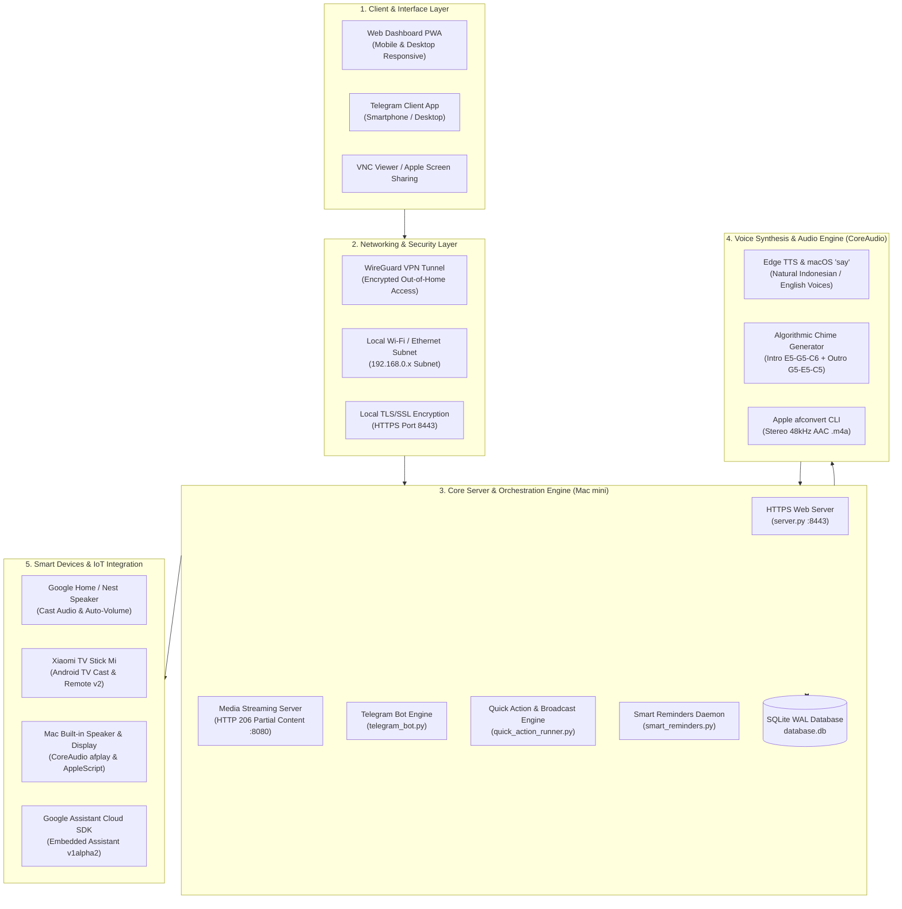

---

## 🔄 End-to-End Workflow Flowchart

The following diagram illustrates how user commands from the Web Dashboard or Telegram Bot are authenticated, synthesized into broadcast audio, and pushed to target endpoints:

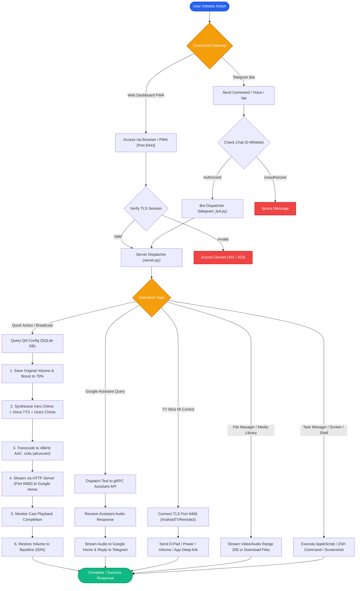

---

## 🛠️ Technology Stack & Dependencies

| Category | Technology / Library | Version / Standard | System Role & Purpose |
| :--- | :--- | :--- | :--- |
| **Language & Runtime** | **Python** | 3.10+ | Primary server backend, automation workers, and bot orchestration. |
| | **JavaScript (ES6+)** | Vanilla JS | High-performance PWA frontend logic with zero framework overhead. |
| | **HTML5 & CSS3** | Modern PWA | Responsive mobile-first liquid glass aesthetics, dark/light themes. |
| **Web & Streaming Server** | **Python `http.server` & `ssl`** | Built-in | Multi-threaded HTTPS Server (Port 8443) with X.509 TLS encryption. |
| | **HTTP Range 206 Server** | Custom Engine | Media streaming server (Port 8080) with byte-range seeking for Chromecast. |
| **Cast & Smart Home IoT** | **PyChromecast** | Latest | Google Cast v2 protocol over TLS (Port 8009) for audio/video streaming. |
| | **AndroidTVRemote2** | Latest | Android TV Remote v2 protocol (TLS Port 6466) for D-Pad, Power, Volume, and app launching. |
| | **Google Assistant SDK** | `v1alpha2` (gRPC) | Headless programmatic text command execution without physical mics. |
| **Audio Processing** | **macOS CoreAudio `afconvert`** | Native CLI | Lossless transcoding of PCM/WAV to Google Cast-compliant AAC (`.m4a`, 48kHz Stereo). |
| | **Algorithmic Chime Bell** | Python `wave` + `math` | Pure synthetic harmonic chime generator (Intro: *E5-G5-C6*, Outro: *G5-E5-C5*). |
| | **Edge TTS & macOS `say`** | Cloud / Built-in | Natural multilingual Text-to-Speech synthesis (Indonesian & English). |
| | **CoreAudio `afplay`** | Native CLI | Hardware audio playback directly through Mac built-in speakers. |
| **Database & Config** | **SQLite 3** | WAL Mode | Persistent ACID storage for Media Library, Macro Scenarios, Schedules, and Quick Actions. |
| | **JSON Config Engine** | Schema-validated | Static configuration for cast targets (`cast_devices.json`) and Telegram bot (`bot_config.json`). |
| **Networking & Remote** | **WireGuard VPN** | UDP Protocol | Encrypted peer-to-peer VPN tunnel for secure remote access without port forwarding. |
| | **Telegram Bot API** | `python-telegram-bot` | 2-way bot interface for telemetry, remote commands, voice notes, and screenshots. |
| | **Apple Screen Sharing** | VNC (Port 5900) | Native high-performance macOS remote desktop access. |
| **System Automation** | **AppleScript (`osascript`)** | Native macOS | OS-level interaction with clipboard, hardware audio levels, and app launching. |
| | **macOS `launchd`** | LaunchDaemons | System supervisor ensuring 24/7 continuous operation and automatic reboot recovery. |

---

## 📸 Dashboard Screenshots (Visual Preview)

### 1. 📁 File Manager (Kodbox-Style Web Explorer)
Access and organize Mac mini storage directly from your phone or laptop with fast navigation, file uploads, Range 206 video streaming, and ZIP extraction.
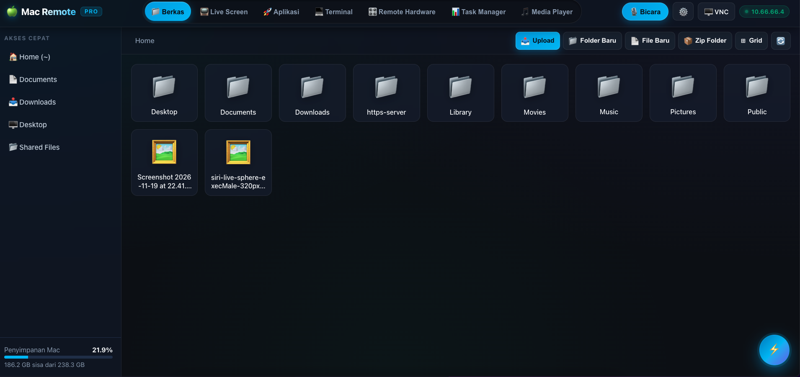

---

### 2. 📢📺 Cast Center & Google Assistant Hub
Unified control to broadcast audio to **Google Home Speakers**, stream video/IPTV to **TV Stick Mi**, and execute text commands to the Google Assistant API.
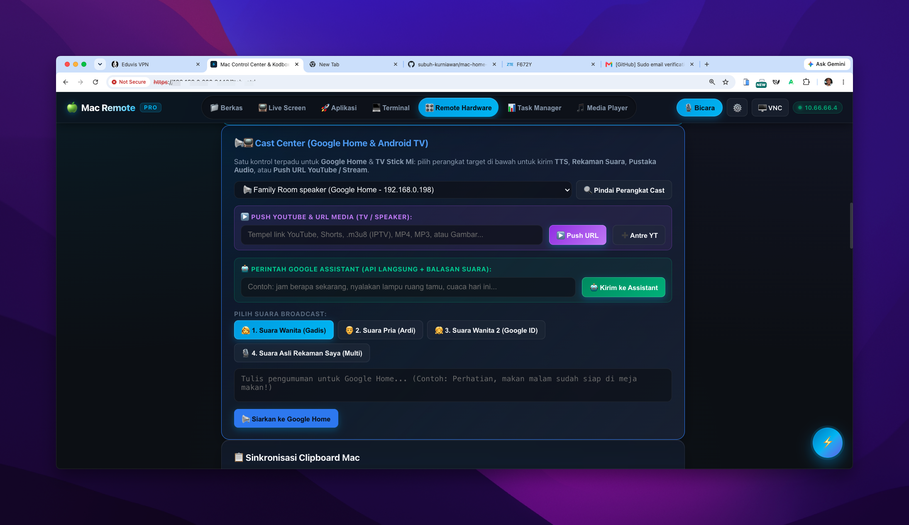

---

### 3. 🎛️ Live Audio Monitor & Instant Stop
Real-time playback monitoring on Google Home and Mac speakers with collision prevention (*Anti-Overlap*), volume sliders, and emergency *Stop All*.
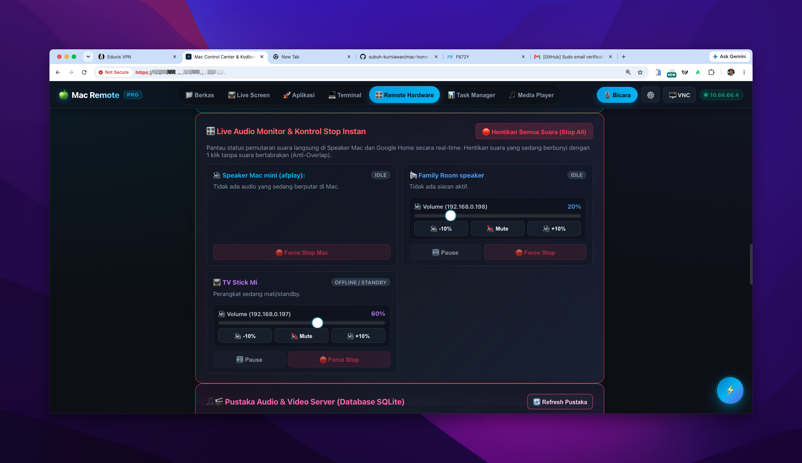

---

### 4. 🎵🎬 Media Library Server (SQLite Database)
Store and play music, audiobooks, or videos on the server with 1-click casting to TV Stick Mi, Google Home (automatic audio extractor), or local Mac speakers.
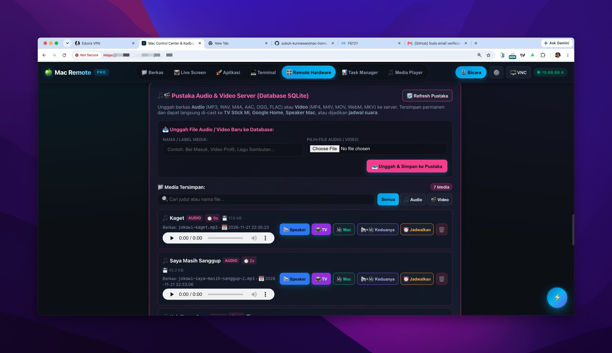

---

### 5. ⏰ Smart Voice Schedules (Cast & Say)
Automate spoken announcements based on specific dates, countdown timers, or recurring daily schedules with natural TTS voices.
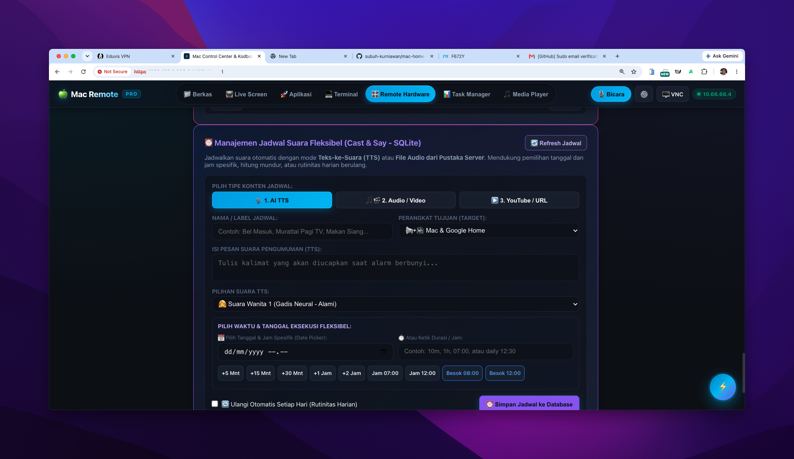

---

### 6. 📊 Mac Task Manager & Process Monitor
Monitor CPU, memory usage, and running macOS processes with the ability to terminate applications directly from the web interface.
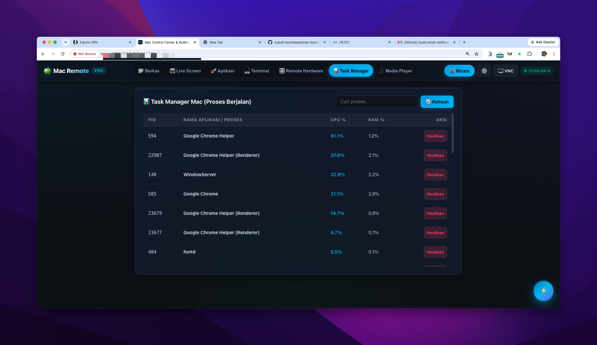

---

### 7. ⚡ 1-Click Automation & Universal Clipboard Sync
Macro routines (*Night Mode, Focus Mode, Away Mode*) combined with bi-directional clipboard synchronization between your Mac and mobile devices.
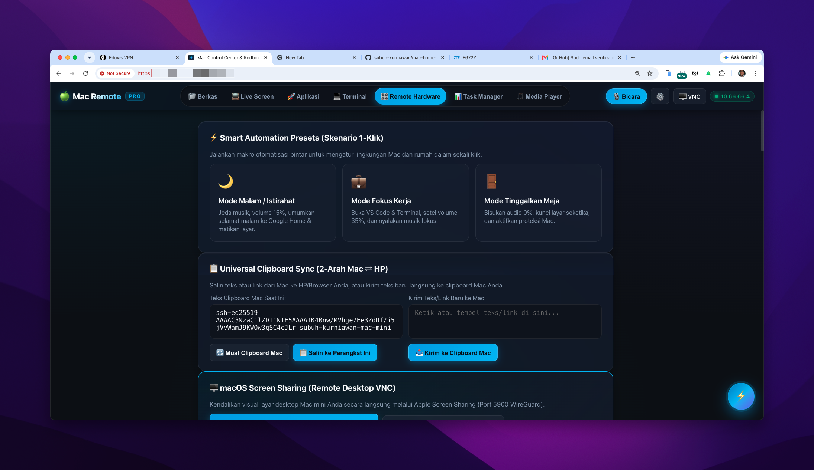

---

### 8. 💻 Mac mini Web Terminal
Execute secure zsh/bash shell commands directly from your browser.
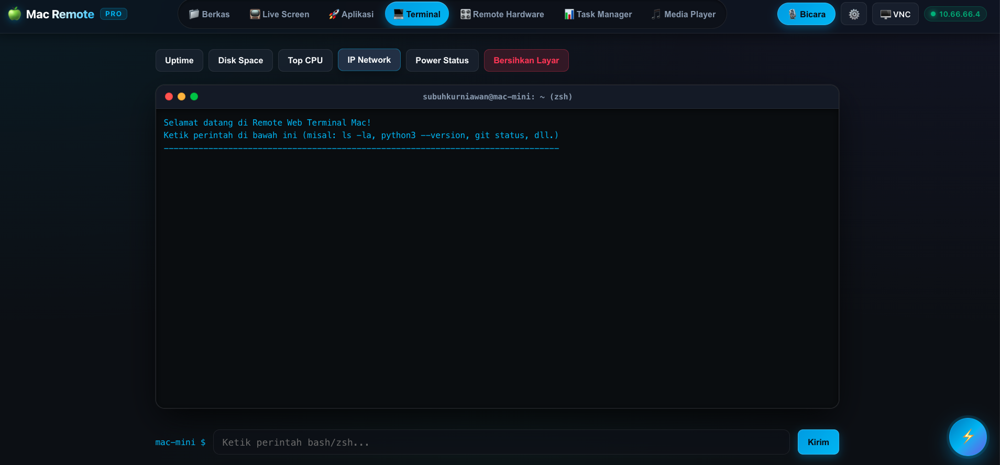

---

### 9. 🚀 App Launcher & URL Opener
Launch applications (Google Chrome, Safari, VS Code, Terminal) or open target URLs on the Mac display with one touch.
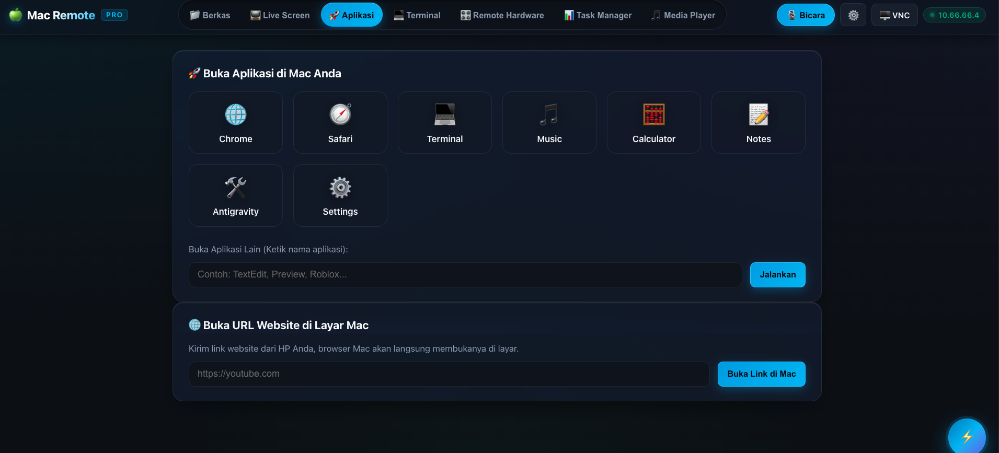

---

### 10. 📺 Live Screen Sharing & Remote Desktop (VNC)
Live visual preview of the Mac display with direct connectivity to macOS Apple Screen Sharing over VNC.
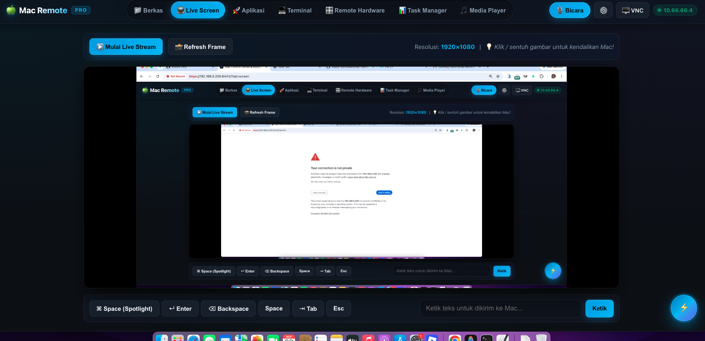

---

## 🌟 Key Highlights

1. **⚡ Quick Action Broadcast & Audio Engine:**
   - **Floating Action Button (FAB `⚡`):** Instant access from any dashboard view.
   - **Harmonic Chimes:** Synthetic opening chime (*E5-G5-C6*, 2.65s) + Natural TTS Voice + Closing chime (*G5-E5-C5*, 1.85s).
   - **Auto Volume Restore:** Volume automatically boosts (default 70%) during broadcast, then restores to 50% (or baseline) once done.
   - **Quiet Hours:** Automatic nighttime volume capping (e.g., 22:00–06:00 max 40%).
   - Full CRUD via Web Dashboard & Telegram Bot.

2. **📢 Static-First Google Cast Hub:**
   - Supports Google Home/Nest Audio & Android TV.
   - *Static-First Mode:* `<1ms` response time utilizing static IP cache without flooding the Wi-Fi router with subnet scans.
   - Android TV Remote v2 (D-Pad, Power, Volume, Home, Back, App Launcher).

3. **🤖 Telegram Bot Controller (`@Subuh_macBot`):**
   - Full Mac control on the go via Telegram.
   - Capture desktop screenshot (`/screen`), check system health (`/status`), execute shell commands (`/cmd`).
   - Quick Action management (`/qa`, `/qaadd`, 1-tap voice toggles).
   - Push voice messages directly to household speakers.

4. **🧠 Google Assistant Embedded SDK (v1alpha2):**
   - Execute Google Assistant commands programmatically via text API without physical microphone hardware.
   - Spoken answers are streamed to Google Home and posted back to Telegram.

5. **⚙️ Centralized Settings Center (5-Tab CRUD):**
   - Telegram Bot Management (Token, Whitelisted Chat IDs with name labels).
   - Cast Devices & Android TV IP Management.
   - Audio Preferences & Quiet Hours volume limit.
   - Google Assistant SDK OAuth Status.
   - SSL Certificate Info & 1-Click System Backup (ZIP).

---

## 📋 System Requirements

- **OS:** macOS (Apple Silicon M1/M2/M3/M4 or Intel Core i5/i7)
- **Runtime:** Python 3.10+
- **Network:** LAN Wi-Fi / Ethernet, optional WireGuard VPN
- **Compatible Devices:** Google Home / Nest Audio / Chromecast / Android TV Stick

---

## 🚀 Quickstart Installation

1. **Clone the Repository:**
   ```bash
   git clone https://github.com/subuh-kurniawan/mac-home-server.git
   cd mac-home-server
   ```

2. **Install Python Dependencies:**
   ```bash
   pip3 install pychromecast google-assistant-grpc google-auth-oauthlib "cryptography<45" androidtvremote2
   ```

3. **Initial Configuration:**
   Copy the example configuration templates:
   ```bash
   cp bot_config.example.json bot_config.json
   cp cast_devices.example.json cast_devices.json
   cp tv_remote_paired.example.json tv_remote_paired.json
   ```
   Edit `bot_config.json` with your Telegram Bot Token and authorized Chat IDs.

4. **Generate Local SSL Certificate (HTTPS):**
   ```bash
   openssl req -x509 -newkey rsa:2048 -nodes -keyout key.pem -out cert.pem -days 365 -subj "/CN=localhost"
   ```

5. **Run Server & Bot Daemon:**
   ```bash
   # Run HTTPS Dashboard & Media Streaming Server (Port 8443 & 8080)
   python3 server.py &

   # Run Telegram Bot Controller
   python3 telegram_bot.py &
   ```

6. **Access Dashboard:**
   Open your browser at `https://localhost:8443` or via your local LAN / WireGuard IP.

---

## 🛡️ Security & Privacy Notice

This repository has been fully sanitized:
- Private keys (`.key`), local certificates (`.pem`, `.crt`), and SQLite databases (`database.db`) are ignored by `.gitignore`.
- Telegram bot tokens, chat IDs, and Google OAuth credentials are excluded (sample templates provided).
- Personal audio libraries and backup archives are excluded from source tracking.

---

## 📄 License

This project is licensed under the **MIT License**.
