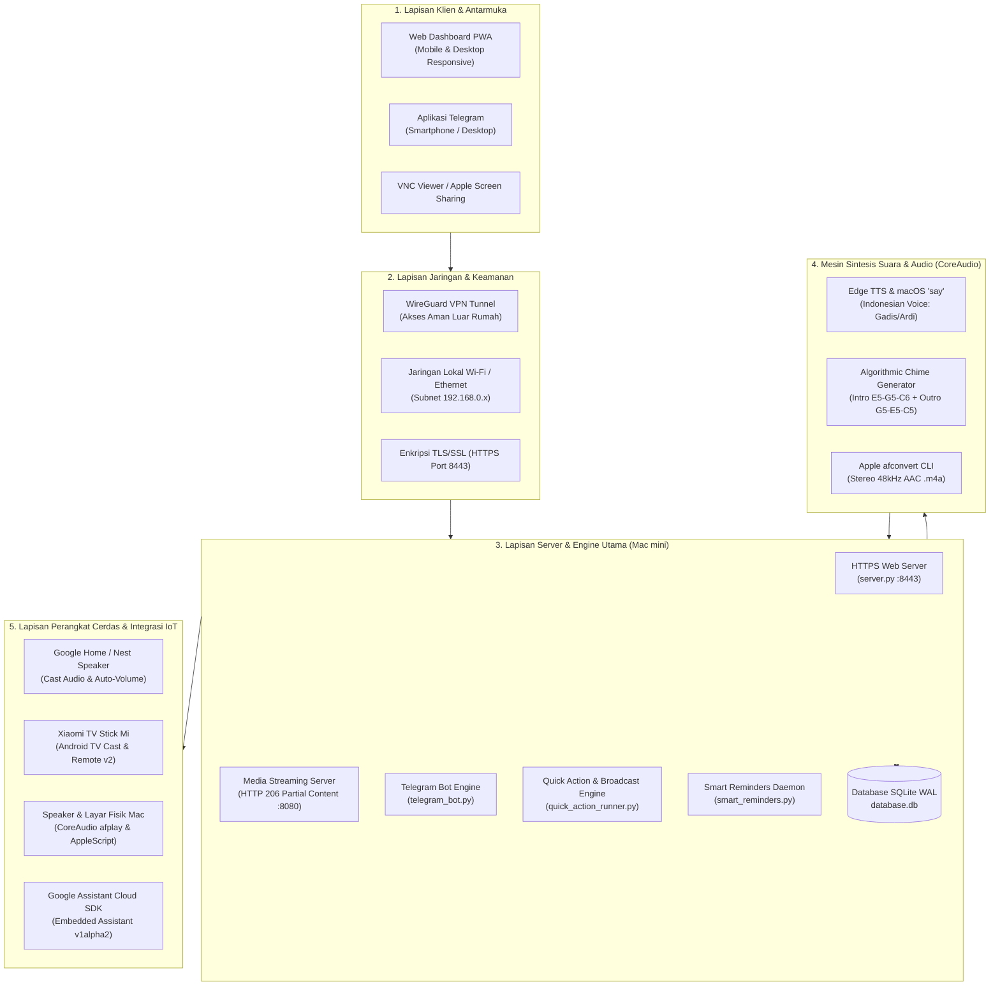
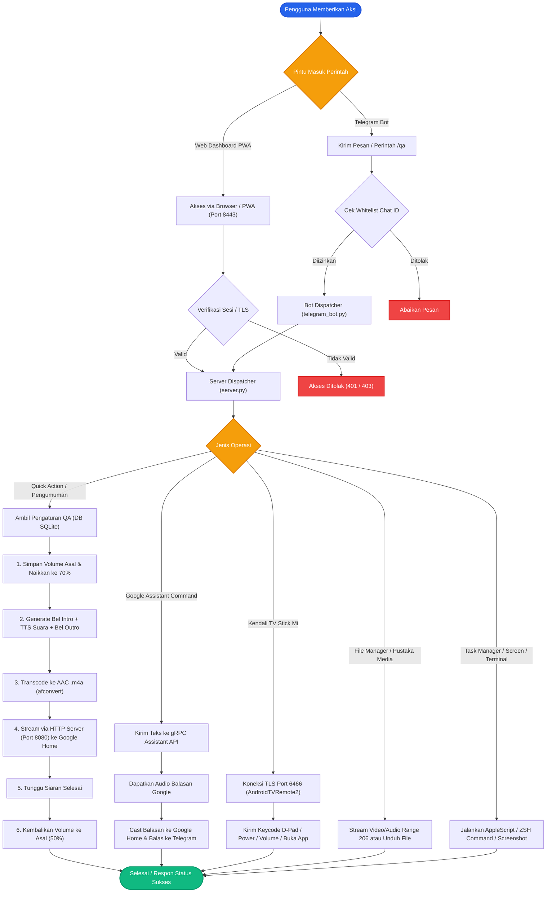
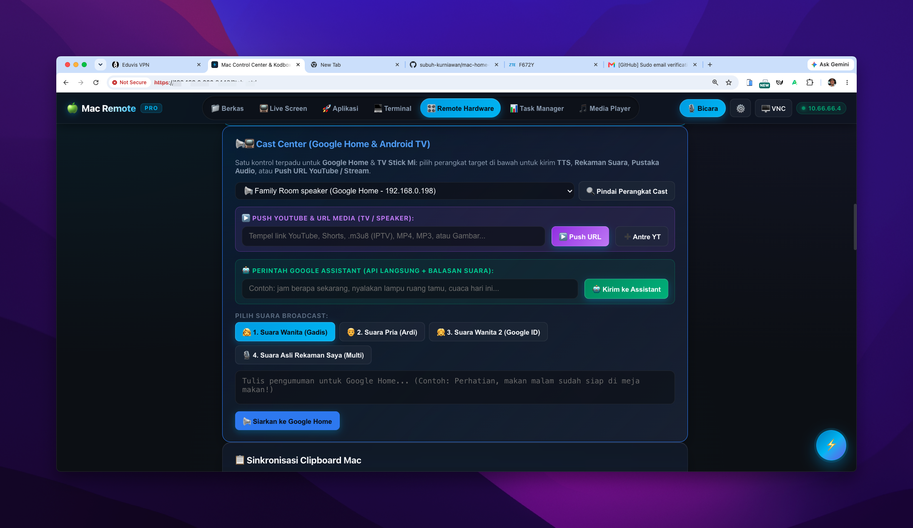
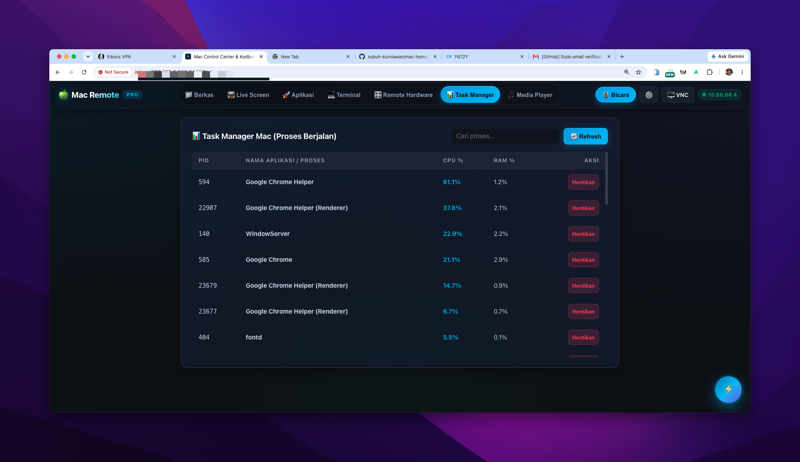
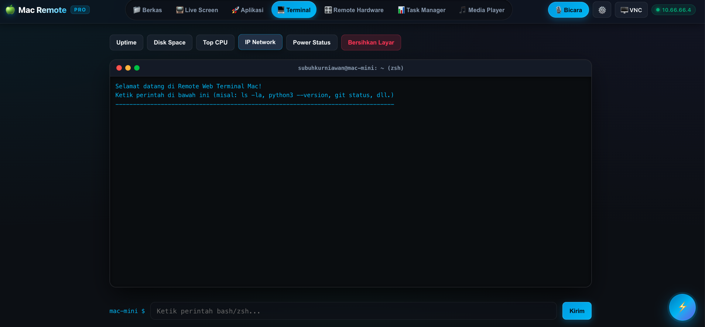
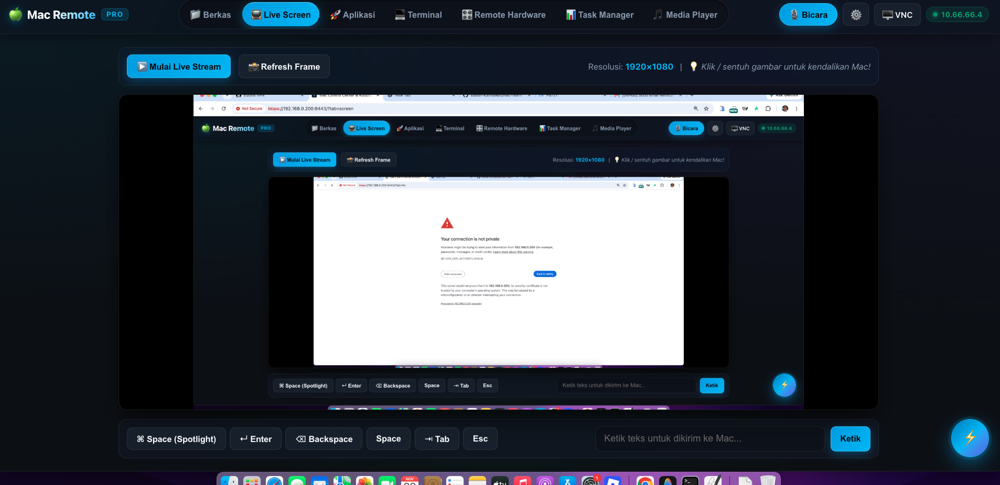

# Mac Home Server & Remote Command Center 🍏⚡

> 🌐 **Language Switch / Pilihan Bahasa:**  
> 👉 **[🇬🇧 Read in English (Switch to README.en.md)](README.en.md)** • **[🇮🇩 Bahasa Indonesia (Versi saat ini)](README.md)**

[](README.en.md)
[](README.md)
[](https://subuh-kurniawan.github.io/mac-home-server/)

[](https://apple.com)
[](https://python.org)
[](https://google.com)
[](https://t.me/Subuh_macBot)
[](https://wireguard.com)
[](LICENSE)

> 🌐 **Live Website / GitHub Pages Showcase:** [https://subuh-kurniawan.github.io/mac-home-server/](https://subuh-kurniawan.github.io/mac-home-server/)
>
> 💡 **Memberi Nyawa Kedua pada Mac Lawas Menjadi Pusat Kendali Rumah Pintar (Home Media Cast Server)**
>
> Banyak komputer Mac lama (seperti Mac mini, MacBook, atau iMac lawas) yang masih memiliki performa tangguh, efisiensi daya tinggi, dan operasional yang sangat hening, namun sering kali berakhir berdebu di sudut meja. Proyek ini lahir dengan tujuan **memanfaatkan kembali perangkat Mac lawas tersebut agar berdaya guna maksimal sebagai Home Media Cast Server & Remote Command Center yang serbaguna**.
>
> Dengan menyulap Mac lawas menjadi server *always-on* 24/7, seluruh ekosistem rumah pintar Anda—mulai dari speaker Google Home, Xiaomi TV Stick (Android TV), media streaming video/audio, jadwal pengumuman keluarga, hingga kendali jarak jauh via Telegram Bot dan WireGuard VPN—dapat dioperasikan secara terpadu tanpa perlu membeli perangkat server baru yang mahal.

---

## 🔮 Visi & Rencana Pengembangan Masa Depan (Future Roadmap)

Meskipun sistem ini pada awalnya dibangun secara khusus memanfaatkan kapabilitas bawaan macOS (seperti AppleScript, CoreAudio `afconvert`, VNC Apple Screen Sharing, dan macOS launchd), **arsitekturnya dirancang modular dan terbuka untuk dikembangkan lebih jauh ke berbagai platform dan perangkat lain**:

- 🐧 **Dukungan Multi-Platform (Linux & Raspberry Pi):** Porting engine server agar dapat dijalankan pada single-board computer hemat daya (seperti Raspberry Pi 4/5) atau distro Linux (Ubuntu/Debian) untuk alternatif server yang lebih fleksibel.
- 🪟 **Dukungan Lingkungan Windows:** Adaptasi modul kontrol hardware, audio engine, dan remote terminal untuk PC/laptop Windows bekas.
- 🌐 **Ekspansi Protokol Audio Smart Home:** Dukungan untuk Apple AirPlay 2 (HomePod), DLNA/UPnP, serta integrasi jembatan IoT (Home Assistant, MQTT, Tuya/Bardi).
- 📱 **Mobile Native Companion App:** Pengembangan aplikasi pendamping Android & iOS dengan widget interaktif untuk Quick Action 1-sentuhan langsung dari lock screen smartphone.

---

## 🏗️ Arsitektur Sistem (System Architecture)

Sistem dibangun dengan arsitektur berlapis (*layered architecture*) yang modular, memisahkan lapisan antarmuka kendali, jaringan aman, logika pemrosesan server, hingga interkoneksi perangkat pintar:



---

## 🔄 Flowchart Alur Kerja (End-to-End Workflow)

Diagram berikut mengilustrasikan alur perintah dari pengguna (melalui Web Dashboard atau Telegram Bot), pemrosesan audio/media cerdas di Mac, hingga dieksekusi pada perangkat target:



---

## 🛠️ Arsitektur Teknologi & Pustaka yang Digunakan

| Kategori | Teknologi / Pustaka | Versi / Standar | Fungsi & Peran dalam Sistem |
| :--- | :--- | :--- | :--- |
| **Bahasa & Runtime** | **Python** | 3.10+ | Bahasa pemrograman utama untuk seluruh core engine server, background worker, dan bot. |
| | **JavaScript (ES6+)** | Vanilla JS | Logika interaktif Web Dashboard PWA tanpa framework eksternal, hemat memori & ultra-responsif. |
| | **HTML5 & CSS3** | Modern Web PWA | Antarmuka mobile-first responsive, dukungan tema dark/light, dan modal interaktif. |
| **Web & Streaming Server** | **Python `http.server` & `ssl`** | Built-in | Server HTTPS multi-threaded (Port 8443) dengan proteksi SSL/TLS self-signed X.509. |
| | **HTTP Range 206 Server** | Custom Engine | Server streaming media (Port 8080) dengan dukungan seeking byte-range untuk Chromecast. |
| **Cast & Smart Home IoT** | **PyChromecast** | Latest | Protokol Google Cast v2 over TLS (Port 8009) untuk streaming audio/video ke Google Home & TV Stick. |
| | **AndroidTVRemote2** | Latest | Protokol Android TV Remote v2 (TLS Port 6466) untuk navigasi D-Pad, tombol Power, volume, dan deep-link app. |
| | **Google Assistant SDK** | `v1alpha2` (gRPC) | Eksekusi perintah pintar Google Assistant secara terprogram via teks tanpa mikrofon fisik. |
| **Audio Processing** | **macOS CoreAudio `afconvert`** | Native CLI | Transcoding audio PCM/WAV ke format standar Google Cast (AAC `.m4a`, 48kHz Stereo). |
| | **Algorithmic Chime Bell** | Python `wave` + `math` | Generator nada bel berharmoni sintetis (Intro: *E5-G5-C6*, Outro: *G5-E5-C5*) tanpa file audio eksternal. |
| | **Edge TTS & macOS `say`** | Built-in / Cloud | Sintesis Text-to-Speech natural bahasa Indonesia (*Gadis*, *Ardi*, dan *Google ID*). |
| | **CoreAudio `afplay`** | Native CLI | Pemutar audio lokal langsung pada hardware speaker fisik Mac mini. |
| **Database & Konfigurasi** | **SQLite 3** | Mode WAL | Penyimpanan persisten untuk Pustaka Media, Skenario Makro, Jadwal Suara Cerdas, dan Quick Action. |
| | **JSON Config Engine** | Schema-validated | Pengaturan statis konfigurasi perangkat cast (`cast_devices.json`) dan Telegram (`bot_config.json`). |
| **Remote & Jaringan** | **WireGuard VPN** | Protocol UDP | Tunnel VPN peer-to-peer terenkripsi untuk akses aman server dari jaringan seluler luar rumah. |
| | **Telegram Bot API** | `python-telegram-bot` | Antarmuka bot dua arah untuk kendali remote, pengiriman notifikasi, audio note, dan screenshot. |
| | **Apple Screen Sharing** | VNC (Port 5900) | Remote desktop visual native macOS dengan performa tinggi. |
| **Otomatisasi Sistem** | **AppleScript (`osascript`)** | Native macOS | Interaksi level sistem dengan clipboard, volume fisik, peluncur aplikasi, dan notifikasi GUI macOS. |
| | **macOS `launchd`** | LaunchDaemons / Agents | Pengelola proses sistem macOS untuk menjalankan server dan bot secara otomatis saat booting (*auto-restart*). |

---

## 📸 Tangkapan Layar Dashboard (Visual Preview)

### 1. 📁 File Manager (Kodbox-Style Web Explorer)
Akses dan kelola file Mac mini langsung dari browser HP atau laptop dengan navigasi cepat, upload berkas, streaming video 206, dan manajemen arsip ZIP.


---

### 2. 📢📺 Cast Center & Google Assistant Hub
Kontrol terpadu untuk siaran ke **Google Home Speaker** & **TV Stick Mi**, push link YouTube/IPTV `.m3u8`, dan kirim perintah teks langsung ke Google Assistant API tanpa mikrofon.


---

### 3. 🎛️ Live Audio Monitor & Kontrol Stop Instan
Pantau status pemutaran secara real-time pada Google Home dan speaker Mac tanpa tabrakan audio (*Anti-Overlap*). Dilengkapi kendali volume dan tombol darurat *Stop All*.


---

### 4. 🎵🎬 Pustaka Audio & Video Server (Database SQLite)
Simpan dan putar musik, murottal, atau video langsung dari server. Mendukung 1-klik cast ke TV Stick Mi, Google Home (audio extractor otomatis), maupun speaker Mac.


---

### 5. ⏰ Manajemen Jadwal Suara Cerdas (Cast & Say)
Jadwalkan pengumuman suara otomatis berbasis tanggal & jam, countdown durasi, atau pengulangan harian dengan pilihan suara TTS bahasa Indonesia alami (*Gadis / Ardi / Google ID*).
- **🔊 Kontrol Volume Presisi & Auto-Restore:** Pengaturan level volume saat alarm berbunyi (10% - 100%) serta pemulihan otomatis (*restore volume*) setelah pengumuman selesai (kembali ke 50%, kembali ke volume awal sebelum alarm, custom level, atau tetap).
- **✏️ Fitur Edit Jadwal Lengkap:** Ubah isi pesan, file media, link URL stream, target speaker, volume, maupun waktu eksekusi secara instan via modal popup interaktif tanpa perlu menghapus jadwal.
- **🎯 Perutean Multi-Target Bebas Interferensi:** Rute pengumuman presisi ke Google Home Saja, Speaker Mac mini Saja, TV Stick Mi, maupun kombinasi serentak dengan penonaktifan suara alert Mac saat casting ke speaker eksternal.


---

### 6. 📊 Task Manager & Monitor Proses macOS
Pantau penggunaan CPU, RAM, dan status aplikasi yang sedang berjalan di Mac mini serta fitur kill proses langsung dari web.


---

### 7. ⚡ Skenario 1-Klik & Universal Clipboard Sync
Otomatisasi makro (*Mode Malam, Mode Kerja, Mode Tinggalkan Meja*) serta sinkronisasi dua arah papan klip (clipboard) antara Mac dan smartphone Anda.


---

### 8. 💻 Web Terminal Mac mini
Eksekusi perintah terminal zsh/bash secara aman dan instan langsung dari antarmuka web.


---

### 9. 🚀 Peluncur Aplikasi & Pembuka URL
Buka Google Chrome, Safari, Terminal, VS Code, atau link website tertentu di layar fisik Mac mini hanya dengan satu sentuhan.


---

### 10. 📺 Live Screen Sharing & Remote Desktop (VNC)
Pantau tampilan layar fisik Mac mini secara berkala dari web atau sambungkan langsung via protokol VNC bawaan macOS Apple Screen Sharing.


---

## 🌟 Fitur Unggulan

1. **⚡ Quick Action Broadcast & Engine Audio Canggih:**
   - **Floating Action Button (FAB `⚡`):** Akses cepat dari halaman mana pun.
   - **Bel Pengumuman Lengkap:** Nada pembuka (*E5-G5-C6*, 2.65s) + Suara TTS (*Gadis/Ardi/Google ID*) + Nada penutup (*G5-E5-C5*, 1.85s).
   - **Auto Volume Restore:** Volume otomatis dinaikkan (default 70%) saat siaran berlangsung, lalu otomatis kembali ke 50% (atau volume sebelumnya) setelah siaran selesai.
   - **Jam Tenang (Quiet Hours):** Batas volume otomatis saat jam malam (misal 22:00–06:00).
   - CRUD penuh via Web Dashboard & Bot Telegram.

2. **📢 Google Cast Static-First Hub:**
   - Mendukung Google Home & Android TV.
   - Mode *Static-First*: Akses instan `<1ms` menggunakan IP statis tanpa membebani Wi-Fi dengan pemindaian 254 IP.
   - Remote Android TV V2 (D-Pad, Power, Volume, Home, Back, Launcher Aplikasi).

3. **🤖 Telegram Bot Controller (`@Subuh_macBot`):**
   - Kendali penuh Mac dari mana saja via chat Telegram.
   - Screenshot layar Mac (`/screen`), Status sistem (`/status`), Eksekusi terminal (`/cmd`).
   - Manajemen Quick Action (`/qa`, `/qaadd`, edit suara & volume 1-tap).
   - Penyiaran Voice Note ke speaker rumah.

4. **🧠 Google Assistant Embedded SDK (v1alpha2):**
   - Eksekusi perintah Google Assistant langsung via API teks tanpa mikrofon fisik.
   - Balasan suara otomatis diputar di Google Home & dikirimkan ke Telegram.

5. **⚙️ Pengaturan Terpusat (5 Tab CRUD):**
   - Manajemen Bot Telegram (Token, Whitelist Chat IDs + Label nama).
   - Manajemen Perangkat Cast & IP Android TV.
   - Preferensi Audio & Jam Tenang.
   - Status Google Assistant SDK.
   - Info Sertifikat SSL & 1-Klik Backup Sistem.

---

## 📋 Persyaratan Sistem

- **OS:** macOS (Apple Silicon M1/M2/M3/M4 atau Intel)
- **Runtime:** Python 3.10+
- **Jaringan:** LAN Wi-Fi / Ethernet, opsional WireGuard VPN
- **Perangkat Pendukung:** Google Home / Nest Audio / Chromecast / Android TV Stick

---

## 🚀 Panduan Instalasi

1. **Clone Repository:**
   ```bash
   git clone https://github.com/subuh-kurniawan/mac-home-server.git
   cd mac-home-server
   ```

2. **Install Dependensi Python:**
   ```bash
   pip3 install pychromecast google-assistant-grpc google-auth-oauthlib "cryptography<45" androidtvremote2
   ```

3. **Konfigurasi Awal:**
   Salin berkas contoh konfigurasi:
   ```bash
   cp bot_config.example.json bot_config.json
   cp cast_devices.example.json cast_devices.json
   cp tv_remote_paired.example.json tv_remote_paired.json
   ```
   Edit `bot_config.json` dengan Token Telegram Bot dan Chat ID Anda.

4. **Generate Sertifikat SSL Lokal (HTTPS):**
   ```bash
   openssl req -x509 -newkey rsa:2048 -nodes -keyout key.pem -out cert.pem -days 365 -subj "/CN=localhost"
   ```

5. **Menjalankan Server & Bot:**
   ```bash
   # Jalankan Server Dashboard HTTPS & Cast Media Server (Port 8443 & 8080)
   python3 server.py

   # Jalankan Telegram Bot Controller
   python3 telegram_bot.py
   ```

6. **Akses Dashboard:**
   Buka browser di `https://localhost:8443` atau melalui IP LAN / WireGuard Anda.

---

## 🛡️ Keamanan & Privasi

Repositori ini telah disterilkan sepenuhnya dari informasi sensitif:
- Token Telegram Bot dan ID Chat tidak dipublikasikan (tersedia `bot_config.example.json`).
- Kunci privat (`.key`) dan sertifikat lokal (`.pem`, `.crt`) diabaikan oleh `.gitignore`.
- Kredensial Google Assistant OAuth tidak disertakan (tersedia `google_client_secret.example.json`).
- Database SQLite lokal (`database.db`), folder audio pribadi, dan backup diabaikan oleh `.gitignore`.

---

## 📄 Lisensi

Proyek ini didistribusikan di bawah lisensi **MIT License**.
