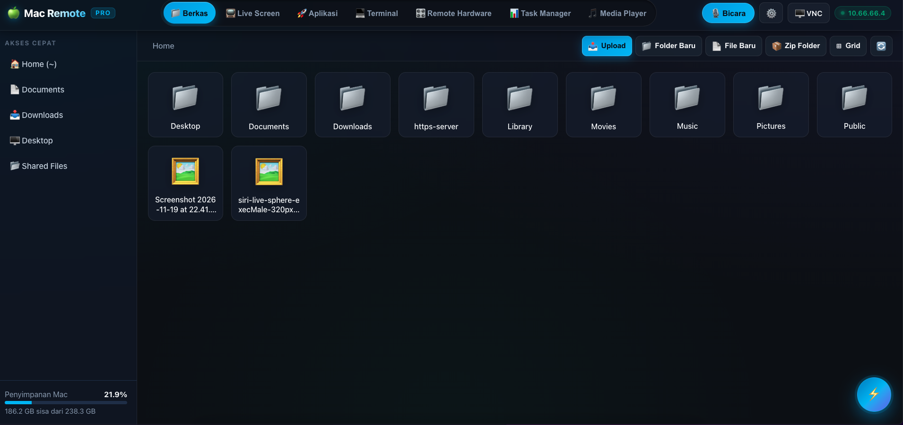
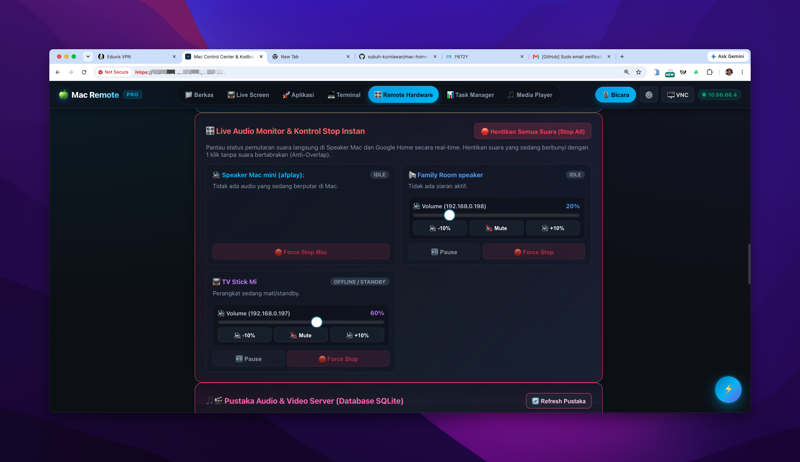
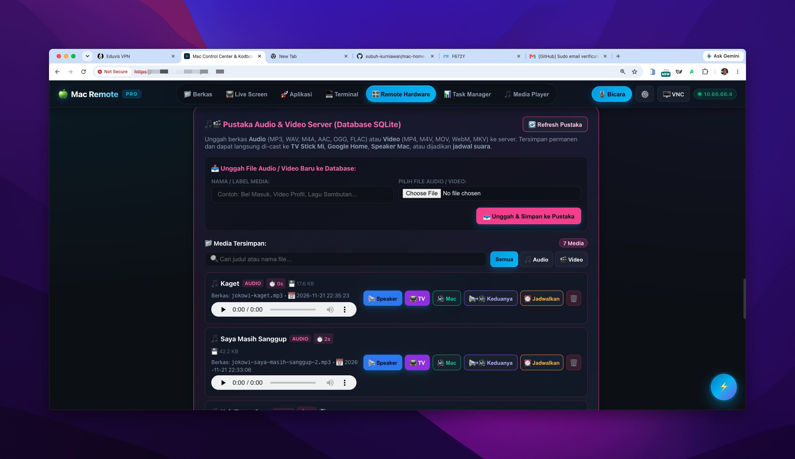
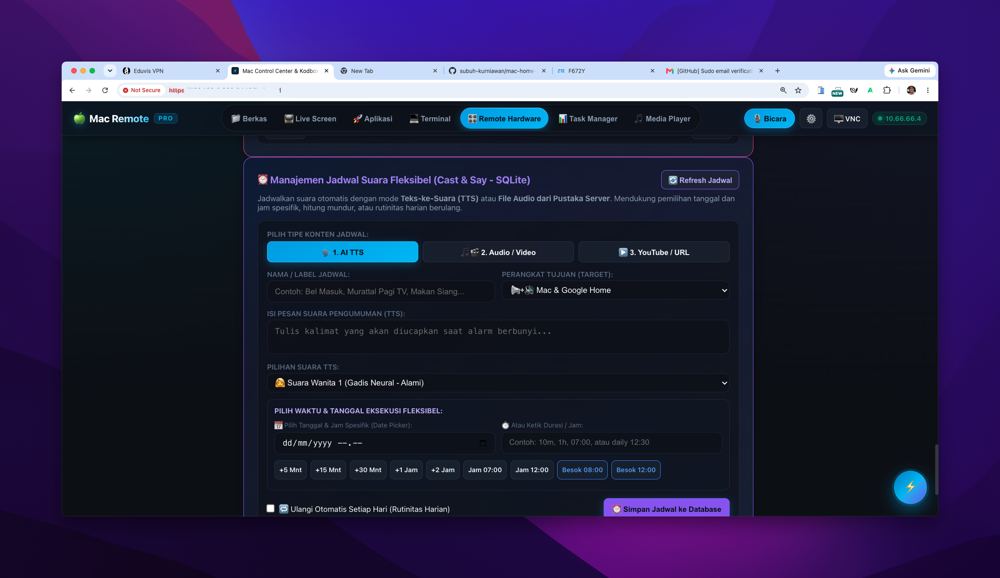
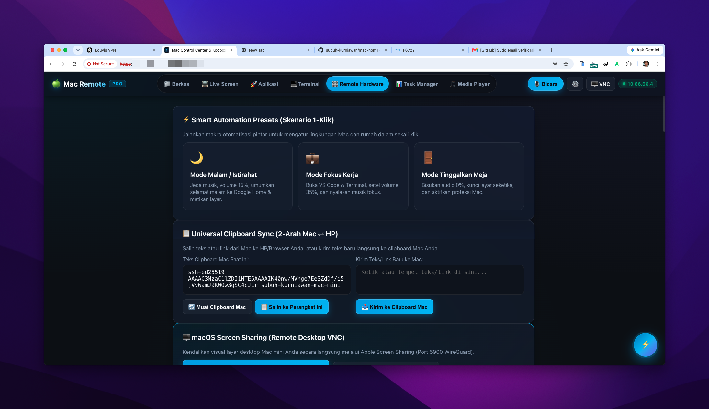
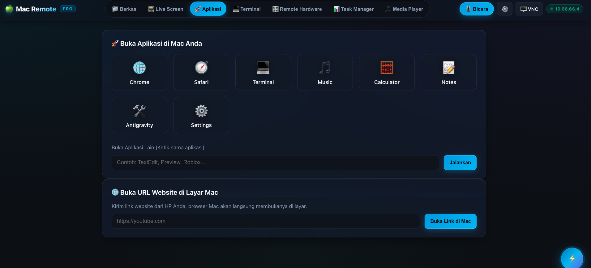

# Mac Home Server & Remote Command Center 🍏⚡

[](https://apple.com)
[](https://python.org)
[](https://google.com)
[](https://t.me/Subuh_macBot)
[](https://wireguard.com)
[](LICENSE)

Sistem terpadu untuk mengendalikan Mac mini, Google Home Speaker, Xiaomi TV Stick (Android TV), Pustaka Audio/Video, dan Bot Telegram dari jarak jauh melalui jaringan lokal maupun WireGuard VPN yang aman.

---

## 📸 Tangkapan Layar Dashboard (Visual Preview)

### 1. 📁 File Manager (Kodbox-Style Web Explorer)
Akses dan kelola file Mac mini langsung dari browser HP atau laptop dengan navigasi cepat, upload berkas, streaming video 206, dan manajemen arsip ZIP.


---

### 2. 📢📺 Cast Center & Google Assistant Hub
Kontrol terpadu untuk siaran ke **Google Home Speaker** & **TV Stick Mi**, push link YouTube/IPTV `.m3u8`, dan kirim perintah teks langsung ke Google Assistant API tanpa mikrofon.


---

### 3. 🎛️ Live Audio Monitor & Kontrol Stop Instan
Pantau status pemutaran secara real-time pada Google Home dan speaker Mac tanpa tabrakan audio (*Anti-Overlap*). Dilengkapi kendali volume dan tombol darurat *Stop All*.


---

### 4. 🎵🎬 Pustaka Audio & Video Server (Database SQLite)
Simpan dan putar musik, murottal, atau video langsung dari server. Mendukung 1-klik cast ke TV Stick Mi, Google Home (audio extractor otomatis), maupun speaker Mac.


---

### 5. ⏰ Manajemen Jadwal Suara Cerdas (Cast & Say)
Jadwalkan pengumuman suara otomatis berbasis tanggal & jam, countdown durasi, atau pengulangan harian dengan pilihan suara TTS bahasa Indonesia alami (*Gadis / Ardi / Google ID*).


---

### 6. 📊 Task Manager & Monitor Proses macOS
Pantau penggunaan CPU, RAM, dan status aplikasi yang sedang berjalan di Mac mini serta fitur kill proses langsung dari web.


---

### 7. ⚡ Skenario 1-Klik & Universal Clipboard Sync
Otomatisasi makro (*Mode Malam, Mode Kerja, Mode Tinggalkan Meja*) serta sinkronisasi dua arah papan klip (clipboard) antara Mac dan smartphone Anda.


---

### 8. 💻 Web Terminal Mac mini
Eksekusi perintah terminal zsh/bash secara aman dan instan langsung dari antarmuka web.


---

### 9. 🚀 Peluncur Aplikasi & Pembuka URL
Buka Google Chrome, Safari, Terminal, VS Code, atau link website tertentu di layar fisik Mac mini hanya dengan satu sentuhan.


---

### 10. 📺 Live Screen Sharing & Remote Desktop (VNC)
Pantau tampilan layar fisik Mac mini secara berkala dari web atau sambungkan langsung via protokol VNC bawaan macOS Apple Screen Sharing.


---

## 🌟 Fitur Unggulan

1. **⚡ Quick Action Broadcast & Engine Audio Canggih:**
   - **Floating Action Button (FAB `⚡`):** Akses cepat dari halaman mana pun.
   - **Bel Pengumuman Lengkap:** Nada pembuka (*E5-G5-C6*, 2.65s) + Suara TTS (*Gadis/Ardi/Google ID*) + Nada penutup (*G5-E5-C5*, 1.85s).
   - **Auto Volume Restore:** Volume otomatis dinaikkan (default 70%) saat siaran berlangsung, lalu otomatis kembali ke 50% (atau volume sebelumnya) setelah siaran selesai.
   - **Jam Tenang (Quiet Hours):** Batas volume otomatis saat jam malam (misal 22:00–06:00).
   - CRUD penuh via Web Dashboard & Bot Telegram.

2. **📢 Google Cast Static-First Hub:**
   - Mendukung Google Home & Android TV.
   - Mode *Static-First*: Akses instan `<1ms` menggunakan IP statis tanpa membebani Wi-Fi dengan pemindaian 254 IP.
   - Remote Android TV V2 (D-Pad, Power, Volume, Home, Back, Launcher Aplikasi).

3. **🤖 Telegram Bot Controller (`@Subuh_macBot`):**
   - Kendali penuh Mac dari mana saja via chat Telegram.
   - Screenshot layar Mac (`/screen`), Status sistem (`/status`), Eksekusi terminal (`/cmd`).
   - Manajemen Quick Action (`/qa`, `/qaadd`, edit suara & volume 1-tap).
   - Penyiaran Voice Note ke speaker rumah.

4. **🧠 Google Assistant Embedded SDK (v1alpha2):**
   - Eksekusi perintah Google Assistant langsung via API teks tanpa mikrofon fisik.
   - Balasan suara otomatis diputar di Google Home & dikirimkan ke Telegram.

5. **⚙️ Pengaturan Terpusat (5 Tab CRUD):**
   - Manajemen Bot Telegram (Token, Whitelist Chat IDs + Label nama).
   - Manajemen Perangkat Cast & IP Android TV.
   - Preferensi Audio & Jam Tenang.
   - Status Google Assistant SDK.
   - Info Sertifikat SSL & 1-Klik Backup Sistem.

---

## 📋 Persyaratan Sistem

- **OS:** macOS (Apple Silicon M1/M2/M3/M4 atau Intel)
- **Runtime:** Python 3.10+
- **Jaringan:** LAN Wi-Fi / Ethernet, opsional WireGuard VPN
- **Perangkat Pendukung:** Google Home / Nest Audio / Chromecast / Android TV Stick

---

## 🚀 Panduan Instalasi

1. **Clone Repository:**
   ```bash
   git clone https://github.com/subuh-kurniawan/mac-home-server.git
   cd mac-home-server
   ```

2. **Install Dependensi Python:**
   ```bash
   pip3 install pychromecast google-assistant-grpc google-auth-oauthlib "cryptography<45" androidtvremote2
   ```

3. **Konfigurasi Awal:**
   Salin berkas contoh konfigurasi:
   ```bash
   cp bot_config.example.json bot_config.json
   cp cast_devices.example.json cast_devices.json
   cp tv_remote_paired.example.json tv_remote_paired.json
   ```
   Edit `bot_config.json` dengan Token Telegram Bot dan Chat ID Anda.

4. **Generate Sertifikat SSL Lokal (HTTPS):**
   ```bash
   openssl req -x509 -newkey rsa:2048 -nodes -keyout key.pem -out cert.pem -days 365 -subj "/CN=localhost"
   ```

5. **Menjalankan Server & Bot:**
   ```bash
   # Jalankan Server Dashboard HTTPS & Cast Media Server (Port 8443 & 8080)
   python3 server.py

   # Jalankan Telegram Bot Controller
   python3 telegram_bot.py
   ```

6. **Akses Dashboard:**
   Buka browser di `https://localhost:8443` atau melalui IP LAN / WireGuard Anda.

---

## 🛡️ Keamanan & Privasi

Repositori ini telah disterilkan sepenuhnya dari informasi sensitif:
- Token Telegram Bot dan ID Chat tidak dipublikasikan (tersedia `bot_config.example.json`).
- Kunci privat (`.key`) dan sertifikat lokal (`.pem`, `.crt`) diabaikan oleh `.gitignore`.
- Kredensial Google Assistant OAuth tidak disertakan (tersedia `google_client_secret.example.json`).
- Database SQLite lokal (`database.db`), folder audio pribadi, dan backup diabaikan oleh `.gitignore`.

---

## 📄 Lisensi

Proyek ini didistribusikan di bawah lisensi **MIT License**.
